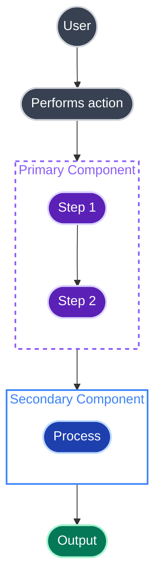

# Mermaid Diagram Generator

Generate high-quality Mermaid diagram code based on user requirements.

## Workflow

1. Understand requirements: analyze user description to determine the most suitable diagram type.
2. Read documentation: read the corresponding syntax reference for the diagram type.
3. Generate code: generate Mermaid code following the specification.
4. Apply styling: apply the dark-fill styling rules below for GitHub and cross-platform readability.

## Diagram Type Reference

Select the appropriate diagram type and read the corresponding documentation:

| Type | Documentation | Use Cases |
| ---- | ------------- | --------- |
| Flowchart | [flowchart.md](references/flowchart.md) | Processes, decisions, steps |
| Sequence Diagram | [sequenceDiagram.md](references/sequenceDiagram.md) | Interactions, messaging, API calls |
| Class Diagram | [classDiagram.md](references/classDiagram.md) | Class structure, inheritance, associations |
| State Diagram | [stateDiagram.md](references/stateDiagram.md) | State machines, state transitions |
| ER Diagram | [entityRelationshipDiagram.md](references/entityRelationshipDiagram.md) | Database design, entity relationships |
| Gantt Chart | [gantt.md](references/gantt.md) | Project planning, timelines |
| Pie Chart | [pie.md](references/pie.md) | Proportions, distributions |
| Mindmap | [mindmap.md](references/mindmap.md) | Hierarchical structures, knowledge graphs |
| Timeline | [timeline.md](references/timeline.md) | Historical events, milestones |
| Git Graph | [gitgraph.md](references/gitgraph.md) | Branches, merges, versions |
| Quadrant Chart | [quadrantChart.md](references/quadrantChart.md) | Four-quadrant analysis |
| Requirement Diagram | [requirementDiagram.md](references/requirementDiagram.md) | Requirements traceability |
| C4 Diagram | [c4.md](references/c4.md) | System architecture (C4 model) |
| Sankey Diagram | [sankey.md](references/sankey.md) | Flow, conversions |
| XY Chart | [xyChart.md](references/xyChart.md) | Line charts, bar charts |
| Block Diagram | [block.md](references/block.md) | System components, modules |
| Packet Diagram | [packet.md](references/packet.md) | Network protocols, data structures |
| Kanban | [kanban.md](references/kanban.md) | Task management, workflows |
| Architecture Diagram | [architecture.md](references/architecture.md) | System architecture |
| Radar Chart | [radar.md](references/radar.md) | Multi-dimensional comparison |
| Treemap | [treemap.md](references/treemap.md) | Hierarchical data visualization |
| User Journey | [userJourney.md](references/userJourney.md) | User experience flows |
| ZenUML | [zenuml.md](references/zenuml.md) | Sequence diagrams (code style) |

## Configuration and Themes

- [Theming](references/config-theming.md) - Custom colors and styles
- [Directives](references/config-directives.md) - Diagram-level configuration
- [Layouts](references/config-layouts.md) - Layout direction and spacing
- [Configuration](references/config-configuration.md) - Global settings
- [Math](references/config-math.md) - LaTeX math support

## Styling Rules

### The Golden Rule: Dark Fills Plus Light Strokes

Use dark fills with light strokes so nodes remain readable in both light and dark mode:

```
classDef myStyle fill:#DARK_COLOUR,stroke:#LIGHT_COLOUR,stroke-width:2px,color:#fff
```

- Fill: use a darker shade for the node background.
- Stroke: use a lighter shade from the same colour family for the border.
- Color: use `#fff` for white text on a dark background.

### Colour Palette

| Fill (Dark) | Stroke (Light) | Result |
|-------------|----------------|--------|
| `#374151` | `#d1d5db` | Grey |
| `#5b21b6` | `#ddd6fe` | Purple |
| `#1e40af` | `#bfdbfe` | Blue |
| `#c2410c` | `#fed7aa` | Orange |
| `#047857` | `#a7f3d0` | Green |
| `#b91c1c` | `#fecaca` | Red |
| `#0f766e` | `#99f6e4` | Teal |

### Node Shapes

Use rounded shapes instead of square brackets:

```text
A(["Stadium shape"])     %% Rounded ends, use for most nodes
B((Circle))              %% Circle, use for users or actors
C{{"Decision"}}          %% Hexagon, use for decisions
D[(Database)]            %% Cylinder, use for databases or storage
```

### Subgraph Syntax

Always quote subgraph labels:

```text
subgraph MyGroup["Label With Spaces"]
```

Style subgraphs with transparent fills so they adapt to any background:

```text
style MySubgraph fill:none,stroke:#8b5cf6,stroke-width:2px,stroke-dasharray:5 5,color:#8b5cf6
```

### Link Styles

```text
A --> B              %% Solid arrow
A -.-> B             %% Dashed arrow
A -.->|Label| B      %% Dashed arrow with label
A ==> B              %% Thick arrow
```

### classDef Placement

Define `classDef` styles at the top of the diagram so styling stays maintainable.

## GitHub-Compatible Template



## Output Specification

Generated Mermaid code should:

1. Be wrapped in ```mermaid code blocks.
2. Have correct syntax that renders directly.
3. Have clear structure with proper line breaks and indentation.
4. Use semantic node naming.
5. Follow the dark-fill styling rules above.

## Common Mistakes

- Font Awesome icons: GitHub does not support `fa:fa-*` icons in Mermaid. They render as literal text.
- Light fills with dark text: `fill:#ffffff,color:#000000` becomes invisible in dark mode.
- Coloured subgraph fills: use `fill:none` instead.
- Unquoted subgraph labels with spaces: causes parse errors.
- HTML in labels: Mermaid node labels cannot use HTML such as `<br>`.

## GitHub-Specific Notes

1. GitHub's Mermaid renderer does not support Font Awesome icons.
2. Subgraph labels with spaces need quotes.
3. Test complex diagrams in [mermaid.live](https://mermaid.live) before committing.

## Quick Reference

```text
flowchart TD
    %% 1. Define styles: dark fill plus light stroke plus white text.
    classDef myStyle fill:#DARK,stroke:#LIGHT,stroke-width:2px,color:#fff

    %% 2. Use rounded shapes.
    Node(["Text"]):::myStyle

    %% 3. Quote subgraph labels.
    subgraph Sub["My Label"]
        Inner(["Inner"])
    end

    %% 4. Style subgraphs with fill:none.
    style Sub fill:none,stroke:#COLOR,stroke-width:2px,color:#COLOR
```